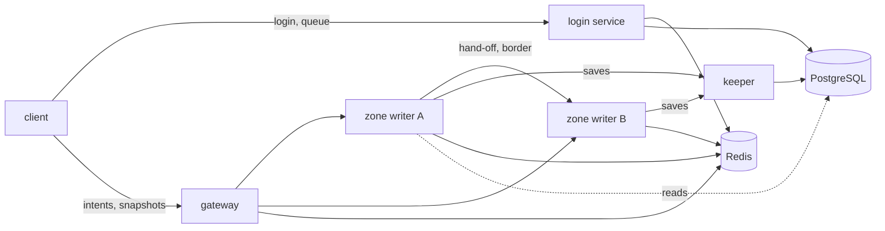

# The architecture of mmo-archi

This document is the one home of the design of the game. Each crate of `crates/` serves it. `AGENTS.md` fixes the shape
of the game, and this document gives its details and its numbers. When the two disagree, `AGENTS.md` wins, and this
document changes.

A number here comes from a measurement, unless its line says "estimate". Section 7 tells how each measurement ran. The
load test of section 12 must prove each number again with the crates of the game.

## 1. The targets

| Target | Value |
| --- | --- |
| Players online in one world at the same time | 5000 |
| Rate of the simulation | 20 ticks each second (50 ms) |
| Players in one zone, hard cap | 2500 |
| Entities that one player sees, cap | 64 |
| Data to one client, mean and worst | 5.0 KB/s and 18.8 KB/s |
| Data from one client | 1.8 KB/s |
| Play that a player loses when a zone writer stops | 10 s at most |
| Time until play starts again after a zone writer stops | 10 s (estimate) |
| Data that the game loses when a gateway stops | none |

## 2. The processes



Each process is the binary of one crate. Each link is QUIC (section 4). The process manager of the operator starts each
process and starts it again when it stops. The directory of zones is not a process: it is data in Redis, and each zone
writer writes the entry of its own zone.

| Process | It alone writes | It reads | When it stops |
| --- | --- | --- | --- |
| Login service | the accounts, the sessions, the queue and the set of admitted players | PostgreSQL, Redis | Another copy serves the clients. The queue stays in Redis. |
| Gateway | nothing | Redis, the message | Its clients connect to another gateway. The game loses no data. |
| Zone writer | the state of its zone, its entry in the directory, the presence of its players | Redis, PostgreSQL, the messages of its players | A new writer takes the zone in about 10 s. Players lose 10 s of play at most. |
| Keeper | the characters, the items and the epoch of each zone in PostgreSQL | the save batches | The zone writers keep the dirty state and send it again. No save is lost. |

### The login service

The login service checks a name and a password, and gives a session. It owns the admission queue of section 8. It keeps
in its memory nothing that a client needs. Each copy reads and writes Redis, so any copy serves any client. The operator
runs two copies or more.

A password goes in the table `accounts` as an argon2id hash in the PHC format, with 19 MiB of memory, 2 passes and 1
lane. One check took 9.8 ms on one core (section 7). A client sends at most 5 failed logins each minute for one name.

After a login, the player selects a character. The login service reads the characters of the account and writes the
session `session:{token}` with the account, the character and the zone of the character. The token is 32 random bytes
from the random source of the system. The login service refuses a new session while the presence of the account stands,
so a player never holds two copies of one character.

### The gateway

The gateway ends the QUIC connection of a client, and checks the session in Redis when the connection opens. It sends
each message to the zone writer that the message names. It keeps only its open connections and a copy of the directory
of zones. It can drop the copy at any time and read it again from Redis. It reads it again at each message on the
channel `directory`, and each 5 s.

Each datagram of a client names the zone that the client is in (section 4), so the gateway keeps no state for a player.
A zone writer drops a message for a player that it does not hold, so a false zone in a message reaches no state.

When a gateway stops, its clients see the connection close within 3 s, the idle timeout of QUIC. Each client connects to
another gateway with its session token. The zone writer keeps a player whose link closed in the world for 30 s, so the
player comes back to the same state.

### The zone writer

The zone writer is the one authority of the state of its zone. It runs the tick of section 5, checks each intent and
sends each snapshot. It moves a player to another zone with the hand-off of section 6.

A writer claims its zone in two steps. First it asks the keeper for the next epoch of the zone, which the keeper writes
in PostgreSQL. Then it writes the entry `zone:{id}` in Redis with its address, its epoch and its count of players. The
entry has a lease of 3 s, which the writer renews each second. Each save of the writer carries its epoch, and the keeper
refuses a save with an old epoch. So a writer that lost its zone, but still runs, writes nothing.

When a writer stops, its lease ends after 3 s. The process manager starts a new writer, which claims the next epoch. It
reads the presence keys of its zone in Redis, and loads the last save of each of those players from PostgreSQL. The
gateways see the change of the directory and send the players to the new writer, which sends each player a full
snapshot.

### The keeper

The keeper is the one writer of the game data in PostgreSQL: the characters, the items and the epoch of each zone. It
runs the migrations when it starts (section 9). It receives the save batches of the zone writers, writes each batch in
one transaction, and acknowledges it. One keeper keeps the count of connections to PostgreSQL small, 16 at most.

When the keeper stops, each zone writer keeps in memory the last state of each dirty character. That is one row for each
character, so the memory does not grow with time. It sends the rows again when the keeper comes back. An act that needs
a commit before the player sees it, as a trade, fails with a message to try again later. A logout waits for its save.

## 3. The stores

Redis holds the short shared state. The game can lose it and make it again: the players log in again, and the zone
writers write the directory and the presence again.

| Key | Type | Writer | Life | Content |
| --- | --- | --- | --- | --- |
| `session:{token}` | hash | login service | 24 h, or until logout | account, character, zone |
| `presence:{account}` | hash | zone writer | 30 s, renewed each 10 s | character, zone, epoch |
| `zone:{id}` | hash | zone writer | 3 s, renewed each 1 s | address, epoch, players |
| `directory` | channel | zone writer | none | the id of each zone that changed its writer |
| `world:{w}:queue` | sorted set | login service | none | the queued accounts, by the time that each entered |
| `world:{w}:admitted` | sorted set | login service | none | the admitted accounts, by the end of their slot |
| `world:{w}:admissions` | sorted set | login service | 10 minutes | the admitted accounts, by the time of their admission |
| `queued:{account}` | string | login service | 120 s, renewed by the client | the mark that a queued client still waits |
| `admit:{account}` | string | login service | 60 s | the mark that the account has a slot |
| `resume:{token}` | string | login service | 120 s | the account of a queued client that can come back |
| `failed:{name}` | string | login service | 60 s | the count of the failed logins of a name in the last minute |
| `chat:{channel}` | stream and channel | zone writer | the last 1000 lines | the chat |

A token goes in a key as 64 hex digits in lower case. The module `keys` of `mmo-store` makes each key, so no other
crate writes the name of a key.

The zone writer sends the chat lines of its players to Redis. It also sends to its players the lines of each channel
that they read. So the gateway keeps no list of channels.

PostgreSQL holds the durable data. Section 9 gives the tables.

## 4. The transport

Each link uses QUIC, with the crate quinn 0.11. QUIC gives TLS 1.3, congestion control, reliable streams and unreliable
datagrams on one connection, so the game has one network stack.

A client opens one connection to a gateway:

- Stream 0, which is reliable and ordered, carries the first message, the orders, the chat and the events, as a move to
  another zone.
- The datagrams carry the intents of movement up, and the snapshots down. A lost snapshot does not stop the next one,
  since each delta starts from a snapshot that the client acknowledged.

A message on a stream is a frame: its length as an unsigned LEB128 number, then its bytes. A frame holds 64 KiB at most,
and a reader closes the stream on a larger frame. A datagram holds one message with no length, of 1100 bytes at most.
QUIC needs a path of 1200 bytes at least, so a datagram of 1100 bytes and its headers always fit.

The codec is bitcode 0.6.9. On a delta of 64 entities it gave 477 bytes, and postcard 1.1.3 gave 805 bytes (section 7).
The format of bitcode can change between its versions. So the crate `mmo-protocol` pins its version with `=`, and a new
version of bitcode raises the version of the protocol.

The state goes on the wire in integers. A position is in centimetres as an `i32`, a speed in centimetres each second as
an `i16`, and a direction of view as a `u16`. These integers made a full snapshot 48 percent smaller than `f32` values
(1073 bytes against 2081 bytes for 64 entities).

The protocol has one version, `PROTOCOL: u16` in `mmo-protocol`. The first message of each side of a link is a
hello: the version as a `u16`, then the build as a `u32`, both little-endian and with no bitcode, so each version reads
the version of each other. A side accepts only its own version, and else answers with its own hello, which carries the
version that it needs. The links between two servers carry the same hello. A change of the protocol needs a restart of the world: the operator stops the world,
deploys each process, and starts it again.

A datagram of a client is `{ zone, ack, inputs }`. It holds the zone of the player, the last tick of a snapshot that the
client received, and the last 3 inputs. The 3 inputs let the writer recover a lost datagram. One input took 11 bytes, so
the datagram is about 30 bytes.

## 5. The simulation

A zone writer runs a fixed tick of 50 ms, 20 times each second. The step of a tick is the constant `DT` of
`mmo-collide`. In each tick the writer:

1. Takes at most one input of each player for this tick, from a buffer of 4 inputs.
2. Checks each input, and moves each player with the step of `mmo-collide`. The step gives each position in whole
   centimetres, so the state of the writer is the state that a client receives.
3. Applies the orders that came on stream 0 since the last tick.
4. Puts each entity in the cell of its position in a grid of 32 m.
5. Makes and sends the snapshot of each player.
6. Sends the dirty characters to the keeper when the save period ends (section 9).

An intent never carries a position or a speed. An input carries a tick, a direction of movement, a direction of view and
flags. The writer reads the speed from its own table. It refuses an input whose tick is more than 4 ticks from its own
tick. It refuses an input of a player that it does not hold, or that comes on another link than the link of the player.
Before it applies an order, it checks the range, the time since the last use and the owner of the item. A player sends
10 orders each second at most.

The interest of a player is the entities in the 9 cells around it. That is 32 m at least in each direction, and 48 m at
most. When more than 64 entities are there, the player sees the 64 nearest, and the lower id goes first when two
distances are equal. The cap of 64 keeps the worst snapshot at 879 bytes, below the limit of a datagram. With a cap of
128, a snapshot in a crowd reached 1610 bytes (section 7).

Each snapshot is a delta against the last snapshot that the client acknowledged. It holds the entities that changed,
with their movement in centimetres since then. It also holds the entities that came into view, and the entities that
left it. The writer keeps the quantized state of each entity for the last 16 ticks. It also keeps the visible ids that
it sent to each player in those ticks. For 2500 players that is 1.3 MB and 10 MB. When the acknowledged tick is older
than 16 ticks (0.8 s), the writer sends a full snapshot, 1073 bytes for 64 entities. When a delta passes 1100 bytes, the
writer leaves the farthest entities out of this tick. They stay changed against the old snapshot, so the next tick sends
them.

The client runs the same step of `mmo-collide` on its own inputs to show its player at once. When a snapshot comes, the
client takes the state of the server at the acknowledged tick and applies its later inputs again.

## 6. The hand-off between two zones

A zone is a square of 1024 m. Each writer sends the quantized state of its entities within 48 m of a border to the
writer of the next zone each tick. The next writer shows them as entities that it does not own, so a player near a
border sees across it.

When a player crosses a border, the writer of the zone that the player leaves, the source, does these steps:

1. It reads the entry of the next zone, the target, in the directory. When the target holds 2500 players, the source
   keeps the player at the border and tells the client why.
2. It stops taking the inputs of the player, and sends `Transfer { account, link, state, version }` to the target.
3. The target adds the player, and writes the presence of the account with its own zone and epoch. It asks the keeper to
   save the character with the new zone. Then it answers `Accepted`.
4. The source drops the player and sends the event `Moved { zone }` to the client. The client names the new zone in its
   next datagram, and the target sends it a full snapshot.

Each save carries the `version` of the character, and the target adds 1 to it. The keeper refuses a save whose version
is not more than the saved one. So when a writer stops during a hand-off, an old copy of the character never writes over
a newer one. No item is made twice. When the source stops before `Accepted`, the character comes back from its last save
in the source zone.

## 7. The capacity

### How the measurements ran

A program outside the repository measured the codec and the tick, on one core of an Apple M5, built for release. It used
parry3d 0.31.1 with the feature `enhanced-determinism`, bitcode 0.6.9 and postcard 1.1.3. The crates of the game must
give the same numbers in the load test.

A snapshot holds, for each entity, an id, a position, a speed, a direction of view, an animation and the hit points. The
sizes are the mean of 200 random snapshots. A delta starts from a snapshot 3 ticks older (150 ms).

| Visible entities | `f32`, full | Integers, full | Delta, all move | Delta, 30 percent move |
| ---: | ---: | ---: | ---: | ---: |
| 16 | 511 (514) | 265 (304) | 122 (197) | 52 (62) |
| 32 | 1015 (1030) | 515 (610) | 221 (391) | 84 (124) |
| 64 | 2081 (2086) | 1073 (1246) | 477 (805) | 157 (248) |
| 128 | 4166 (4199) | 2142 (2518) | 938 (1632) | 300 (493) |
| 256 | 8329 (8422) | 4273 (5060) | 1849 (3282) | 579 (997) |

The sizes are bytes with bitcode, and with postcard in brackets.

The tick ran one zone of 1024 m by 1024 m with 2048 fixed boxes. Each player walked at 6 m/s and changed its direction
at random. It tested a capsule against each box near it with the contact query of parry3d. Then the program put each
player in the grid, chose the visible entities of each player, and made and encoded each delta. It measured 100 ticks
after 20 ticks of warm-up. "Town" puts half of the players in one square of 128 m.

| Players | Town | Cap | Movement (ms) | Interest and encode (ms) | Tick, mean (ms) | Tick, worst (ms) | Visible | Bytes, mean | Bytes, worst |
| ---: | --- | ---: | ---: | ---: | ---: | ---: | ---: | ---: | ---: |
| 500 | no | 64 | 0.11 | 0.17 | 0.28 | 0.34 | 4.0 | 33 | 139 |
| 1000 | no | 64 | 0.16 | 0.39 | 0.55 | 0.65 | 8.4 | 52 | 195 |
| 1000 | yes | 64 | 0.16 | 1.19 | 1.35 | 1.42 | 35.0 | 151 | 848 |
| 1000 | yes | 128 | 0.16 | 1.66 | 1.83 | 1.93 | 65.7 | 261 | 1263 |
| 2500 | no | 64 | 0.39 | 1.85 | 2.25 | 2.38 | 21.4 | 98 | 353 |
| 2500 | yes | 64 | 0.41 | 3.96 | 4.38 | 4.51 | 38.3 | 165 | 879 |
| 2500 | yes | 128 | 0.42 | 5.50 | 5.92 | 6.58 | 71.1 | 281 | 1610 |
| 5000 | no | 64 | 0.78 | 6.14 | 6.92 | 7.10 | 42.4 | 175 | 628 |
| 5000 | yes | 64 | 0.79 | 10.70 | 11.50 | 11.72 | 43.7 | 188 | 822 |

A local PostgreSQL 18 updated 2500 rows of a table of 100000 characters in one statement in 5.7 ms to 10.1 ms, over 5
runs. One check of an argon2id hash took 9.8 ms, the least of 20 runs.

### The budget for 5000 players

The tick of a zone writer has 50 ms. Its target is 25 ms at the 99th percentile, so one slow tick does not delay the
next one.

| Part of a tick at the hard cap of 2500 players | Time |
| --- | --- |
| Movement, grid, interest and encode, measured on an M5, worst | 4.5 ms |
| The same on a server core, if that core is 2 times slower (estimate) | 9 ms |
| Game rules, creatures and saves (estimate, to measure) | 16 ms |
| Total, the target of the 99th percentile | 25 ms |

The world starts with 8 zones, about 625 players in each. A zone has a hard cap of 2500, so a crowd of 2500 in one zone
stays in the budget. All 5000 players in one zone took 11.7 ms on the M5 in the worst tick, so the cap has room.

| Resource | One player | 5000 players | Plan |
| --- | --- | --- | --- |
| Data down | 5.0 KB/s mean, 18.8 KB/s worst | 25 MB/s mean, 94 MB/s worst | 3 gateways (estimate) |
| Data up | 1.8 KB/s | 9 MB/s | the same gateways |
| Zone writer core | | 8 writers | 2 hosts of 8 cores (estimate) |
| Login checks | 9.8 ms once | 49 core-seconds | 2 login services of 4 cores |
| Saves in PostgreSQL | one row each 10 s | 500 rows/s, 8 batches each 10 s | 1 keeper, 1 primary and 1 replica |
| Redis | 0.1 operations/s | about 1000 operations/s | 1 primary and 1 replica |

The data down is the mean snapshot of 188 bytes, or the worst of 879 bytes, 20 times each second. Each datagram adds
about 60 bytes of IP, UDP and QUIC headers (estimate). The data up is a datagram of 30 bytes and its headers, 20 times
each second.

### A full world

When the world holds 5000 admitted players, a new login waits in the queue of section 8. When a zone holds 2500 players,
the zone writer refuses a hand-off into it and the attach of a player whose last zone it is. The login service keeps
that player at the head of the queue until the zone has room.

### Past 5000 players

1. Raise the cap of the world while the tick of each zone stays under 25 ms at the 99th percentile. Add a gateway for
   each 2500 players. Above the cap of 64 visible entities, the cost of interest grows with the count of players, not
   with its square.
2. Cut the map into more zones, each with its own writer.
3. Run copies of a crowded zone, each with its own writer, and put the players of one group in the same copy.
4. Run more worlds. Each world has its own queue, its own Redis and its own zones, and all worlds share the accounts.

## 8. The login queue

Each world has a cap, 5000 at the start. The set `world:{w}:admitted` holds each admitted account, with the time in
milliseconds when its slot ends. The sorted set `world:{w}:queue` holds each queued account, with the time when it
entered.

- A client that logs in while the world is full enters the queue with `ZADD NX`. An account has one place at most, and a
  client that comes back keeps its first place.
- The client renews `queued:{account}` each 5 s. In the same request it gets its position from `ZRANK` and the length of
  the queue. It also gets an estimate of its wait from the admissions of the last 10 minutes.
- Each second, each copy of the login service runs one Lua script, which Redis runs as one atomic step. The script reads
  the time of Redis. For each admitted account whose slot ended, it extends the slot by 30 s when the presence of the
  account stands. Else it removes the account. Then it takes from the head of the queue as many accounts as the world
  has free slots, 100 at most. It skips an account whose `queued:{account}` ended, adds each other account to the
  admitted set with a slot of 60 s, and writes `admit:{account}`.
- The copy of the login service that serves the client sees `admit:{account}`, makes the session and gives the token to
  the client. The client then has 60 s to reach a gateway. When it does not, its slot ends and goes to the next account.
- The zone writer renews the presence of each of its players, so the script keeps their slots. A logout removes the
  account from the admitted set at once.

The queue is fair. The order is the order of entry, and the time comes from Redis and not from a server. Accounts that
entered in the same millisecond keep the fixed order that Redis gives them. Many copies of the script can run, since
each run is atomic and checks the free slots again. A restart of a login service or of a gateway loses no place, since
the queue is in Redis. The client logs in again within 120 s with its `resume:{token}`, and needs no new check of its
password. The limit of 100 admissions each second spreads the loads of characters over time. After a restart of the
world, 5000 players enter in 50 s.

## 9. The persistence

The first tables:

```sql
CREATE TABLE accounts (
  id bigint GENERATED ALWAYS AS IDENTITY PRIMARY KEY,
  name text NOT NULL UNIQUE CHECK (name = lower(name)),
  password_hash text NOT NULL,
  created_at timestamptz NOT NULL DEFAULT now()
);

CREATE TABLE zones (
  id integer PRIMARY KEY,
  name text NOT NULL UNIQUE,
  epoch bigint NOT NULL DEFAULT 0
);

CREATE TABLE characters (
  id bigint GENERATED ALWAYS AS IDENTITY PRIMARY KEY,
  account_id bigint NOT NULL REFERENCES accounts (id),
  name text NOT NULL UNIQUE,
  zone_id integer NOT NULL REFERENCES zones (id),
  x integer NOT NULL,
  y integer NOT NULL,
  z integer NOT NULL,
  yaw integer NOT NULL CHECK (yaw BETWEEN 0 AND 65535),
  hit_points integer NOT NULL,
  version bigint NOT NULL DEFAULT 0,
  saved_at timestamptz NOT NULL DEFAULT now()
);

CREATE INDEX characters_account ON characters (account_id);
```

The position is in whole centimetres and the yaw in steps of 1/65536 of a turn, as the step of `mmo-collide` gives them
and the wire carries them, so a save and a load give the same state. The name of an account is in lower case before it
goes in the table, and the table refuses a name that is not.

The migrations are SQL files in `crates/mmo-store/migrations/`, which sqlx runs in the order of their numbers. The
keeper runs them when it starts, under the lock of sqlx, so two keepers do not run them together. The other processes
check that the database has each migration that they need, and stop with an error when it does not. A migration only
adds: a new column has a default, and a column goes away only after no deployed process reads it.

A zone writer saves at these times:

- Each 10 s, in one batch: each character whose state changed since its last save. For 2500 players the batch took 5.7
  ms to 10.1 ms.
- At a logout. The writer removes the presence only after the keeper acknowledges the save.
- At a hand-off, as section 6 says.
- Before it tells a player the result of an act that changes an item, as a trade or a purchase.

The keeper writes a batch in one transaction. It first locks the row of the zone and checks its epoch. Then it writes
only the characters whose new `version` is greater than the saved one. So a writer that stops loses at most the last 10
s of movement of its players, and never an item.

## 10. The determinism

`mmo-collide` is the one crate that the server and the client share for the step of a body. The same state and the same
inputs give the same bits on each system. These rules hold it:

- The step has one fixed time, the constant `DT` of 1/20 s. No step reads a clock.
- parry3d has the feature `enhanced-determinism`, which uses the software math of libm in simba and glam, and indexmap
  in place of hash maps. The crate does not turn on the feature `parallel` of parry3d.
- The crate holds no `HashMap` and no `HashSet`. It keeps bodies in a `Vec` in the order of their ids.
- The crate calls no sine, cosine or power of the standard library, since their results can change with the system. It
  calls the functions of the crate libm.
- The crate calls no `mul_add`, and no build of the game uses `target-cpu=native`, so the compiler makes no fused
  operation.
- The step gives each position in whole centimetres and each speed in whole centimetres each second, so the client
  starts from the same bits.

The proof is a test in the crate. In it, 1000 bodies run 200 ticks from fixed inputs, and the hash of the bits of their
state equals one constant. The gates run it on Linux, macOS and Windows, as `script/scope.sh` says for this crate. The
measurement program ran the same scene two times on one machine and gave the same hash two times. That run proves
nothing across systems: the test does.

A change of `mmo-collide` changes the result of a step, so it raises the version of the protocol.

## 11. The crates

The crates come in this order, each in its own pull request, and each serves the ones after it. The server stands after
crate 8, and the client follows. Each new crate adds its name to `release-please-config.json`.

| Order | Crate | Its doors |
| ---: | --- | --- |
| 1 | `mmo-protocol` | `PROTOCOL`, the messages of each stream and each datagram, `encode`, `decode`, the reader of frames |
| 2 | `mmo-collide` | `DT`, `Body`, `Input`, `Terrain`, `step(&Terrain, Body, Input) -> Body`, `state_hash` |
| 3 | `mmo-store` | the migrations, the queries of each table, and the name and the format of each key of Redis |
| 4 | `mmo-keeper` | the binary of the keeper, and its messages in `mmo-protocol` |
| 5 | `mmo-zone` | the binary of the zone writer: the tick, the interest, the deltas, the lease and the hand-off |
| 6 | `mmo-gateway` | the binary of the gateway |
| 7 | `mmo-login` | the binary of the login service, with the queue |
| 8 | `mmo-bots` | the headless clients of the load test |
| 9 | `mmo-client` | the binary of the client, with winit, wgpu and the prediction of `mmo-collide` |

`mmo-store` is the one home of each table and each key, so no other crate writes SQL or the name of a key of Redis.

## 12. The load test

`mmo-bots` runs many clients in one process, with no window. Each bot logs in, waits in the queue and connects to a
gateway. It sends inputs 20 times each second from a seeded walk, and acknowledges each snapshot. Sometimes it sends an
order or a chat line. Each bot checks that it can decode each message. The bots run on hosts of the operator, apart from
the hosts of the servers.

| Stage | Bots | What it proves | It passes when |
| --- | ---: | --- | --- |
| 1 | 500 | the path from login to play | each bot plays, and no message fails to decode |
| 2 | 2500 in one zone, half in a town | the hard cap of a zone | the tick is under 25 ms at the 99th percentile and under 50 ms always |
| 3 | 5000 in 8 zones, with crossings | the budget | the data down is under 5 KB/s mean and 20 KB/s at the 99th percentile, the data up is under 2 KB/s, and no datagram passes 1100 bytes |
| 4 | 6000 | the queue | 1000 bots wait, each gets its position each 5 s, and the order of admission is the order of entry |
| 5 | 5000, with faults | the recovery | after a stop of a zone writer, the bots play again within 10 s and lose 10 s of play at most; after a stop of a gateway, they connect again within 5 s; after 60 s with no keeper, no save is lost |

Each zone writer reports the time of each tick, and each bot reports its bytes up and down. The test keeps each report
with the commit that it ran. A short stage 1 with 200 bots runs in the gates on Linux.
