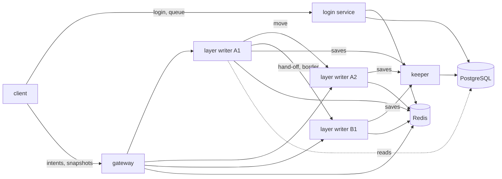
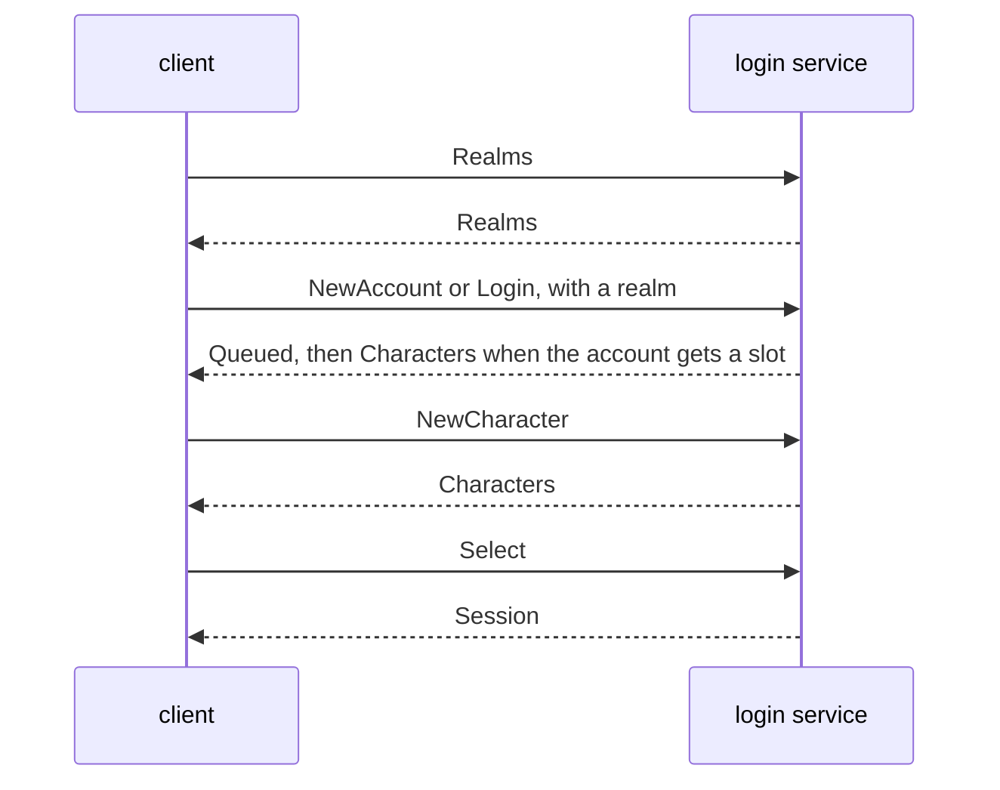

# The architecture of mmo-archi

This document is the one home of the design of the game. Each crate of `crates/` serves it. `AGENTS.md` fixes the shape
of the game, and this document gives its details and its numbers. When the two disagree, `AGENTS.md` wins, and this
document changes.

A number here comes from a measurement, unless its line says "estimate". Section 7 tells how each measurement ran. The
load test of section 12 must prove each number again with the crates of the game.

## 1. The targets

| Target | Value |
| --- | --- |
| Players online in the game at the same time | 10000, in 2 realms |
| Players in one realm, cap | 5000 |
| Players in one layer, cap | 500 |
| Rate of the simulation | 20 ticks each second (50 ms) |
| Entities that one player sees, cap | 64 |
| Data to one client, mean and worst | 5.0 KB/s and 18.8 KB/s |
| Data from one client | 1.8 KB/s |
| Play that a player loses when a layer writer stops | 10 s at most |
| Time until play starts again after a layer writer stops | 10 s (estimate) |
| Data that the game loses when a gateway stops | none |

The game grows by layers and realms (section 6). More layers hold a crowd in one zone, and more realms hold more
players.

## 2. The processes



A1 and A2 are two layers of the zone A, and B1 is a layer of the zone B, in one realm. Each process is the binary of one
crate. Each link is QUIC (section 4). The process manager of the operator starts each process and starts it again when
it stops. The directory is not a process: it is data in Redis, which the scripts of section 6 change, and each layer
writer writes the entry of its own layer. One PostgreSQL, one Redis, one keeper and the gateways serve all the realms,
and each copy of the login service and each layer writer serves one realm.

| Process | It alone writes | It reads | When it stops |
| --- | --- | --- | --- |
| Login service | the accounts, the new characters, the sessions, the entry of its realm, and the queue and the set of admitted players of its realm | PostgreSQL, Redis | Another copy serves the clients. The queue stays in Redis. |
| Gateway | nothing | Redis, the message | Its clients connect to another gateway. The game loses no data. |
| Layer writer | the state of its layer, its entry in the directory, the times of its ticks, the presence of its players | Redis, PostgreSQL, the messages of its players | An idle writer of the realm takes the layer in about 10 s. Players lose 10 s of play at most. |
| Keeper | the saves of the characters, the items and the epoch of each layer in PostgreSQL | the save batches | The layer writers keep the dirty state and send it again. No save is lost. |

### The login service

The login service makes the accounts and the characters, checks a name and a password, and gives a session. It owns the
admission queue of section 8. It keeps in its memory nothing that a client needs. The operator gives each copy one realm
in its config, and runs two copies or more for each realm. Each copy reads and writes Redis, so any copy of a realm
serves any client of that realm, and any copy lists all the realms.

A password goes in the table `accounts` as an argon2id hash in the PHC format, with 19 MiB of memory, 2 passes and 1
lane. One check took 9.8 ms on one core (section 7). One address sends at most 5 failed logins each minute for one
name, and 30 each 10 minutes over all names. The cap of a name holds for one address alone, so a stranger who guesses a
password cannot lock the owner of the account out. One address makes at most 5 accounts each hour. The password of a
new account holds 8 characters at least and 128 bytes at most. A try with a password that breaks this rule makes no
account, and it counts for no limit. A login checks no length, so an older account signs in.

After a login, the player selects a character. The login service reads the characters of the account in the realm of
the login. When the player selects one, it runs the placement of section 6 for the zone of the character, and writes
the session `session:{token}` with the account, the character, the realm, the zone and the layer that the placement
gives.
The token is 32 random bytes
from the random source of the system. The login service refuses a new session while the presence of the account stands,
so a player never holds two copies of one character.

### The gateway

The gateway ends the QUIC connection of a client, and checks the session in Redis when the connection opens. It keeps
the account and the realm of the session with the connection, since a player never changes its realm in a session.
It joins the client to the layer that the presence of the player names, when a layer writer holds the character of the
session in the realm of the session, and else to the layer of the session. A move or a hand-off takes a player out of
the layer of its login, so a client that attaches again after it comes back to the layer that holds its player. It
sends each message to the writer of the layer that the message names, in the realm of the connection. It keeps only
its open connections and a copy of the directory of each realm. It can drop the copy at any time and read it again
from Redis. It reads it again at each message on the channel `directory`, and each 5 s.

Each datagram of a client names the zone and the layer that the client is in (section 4), so the gateway keeps no
state of a player outside its connection. A layer writer drops a message for a player that it does not hold, so a
false zone or layer in a message reaches no state.

Between the gateway and a layer writer, a datagram holds the link of a client in 8 bytes, then the datagram of that
client as it goes on the wire. So the gateway relays each intent and each snapshot with no encode, and it decodes only
the zone and the layer of an intent. The task of the link to a writer sends each snapshot straight to the connection
of its client, with no wake of the task of that client.

When a gateway stops, its clients see the connection close within 3 s, the idle timeout of QUIC. Each client connects
to another gateway with its session token. The layer writer keeps a player whose link closed in its layer for 30 s, so
the player comes back to the same state.

### The layer writer

The layer writer is the one authority of the state of its layer. It runs the tick of section 5, checks each intent and
sends each snapshot. It moves a player to another zone with the hand-off of section 6, and to another layer of its
zone with the move of section 6.

The operator gives each writer one realm. A writer that holds no layer is idle, and section 6 says how it takes a
layer and how it gives it back.

A writer claims its layer in two steps. First it asks the keeper for the next epoch of the layer, which the keeper
writes in PostgreSQL. Then it writes the entry `writer:{r}:{z}:{l}` in Redis with its address and its epoch. The entry
has a lease of 3 s, which the writer renews each second. Each save of the writer carries its epoch, and the keeper
refuses a save with an old epoch. So a writer that lost its layer, but still runs, writes nothing.

When a writer stops, its lease ends after 3 s, and its layer stays in the directory with no writer. An idle writer of
the realm claims it with the next epoch. It reads the presence keys of the layer in Redis, and loads the last save of
each of those players from PostgreSQL. The gateways see the change of the directory and send the players to the new
writer, which sends each player a full snapshot. The process manager starts the stopped writer again, and it is idle.

The writer claims its epoch and sends each save batch on one link to the keeper, which shows the certificate of the
writer. It reads the last save of a player from PostgreSQL itself, and it writes nothing there. The writer renews the
presence of each of its players each 10 s with the save, and it stops, for the process manager to start it again, when
the keeper refuses a batch of its epoch or when the entry of its layer holds a newer epoch.

### The keeper

The keeper is the one writer of the game data in PostgreSQL: the saves of the characters, the items and the epoch of
each layer, for all the realms. The login service only adds a new character, at version 0, which no layer writer holds
yet. The keeper runs the migrations when it starts (section 9). It receives the save batches of the layer writers,
writes each batch in one transaction, and acknowledges it. One keeper keeps the count of connections to PostgreSQL
small, 16 at most.

A layer writer opens one stream to the keeper. After the hello of each side, it sends a claim of its layer or a save
batch, and the keeper answers each in the order of the messages: the epoch that it wrote, the count of the characters
that it wrote, or a refusal. A batch goes in one frame, so it holds 1926 saves at most, and a writer with more dirty
characters sends more batches. The keeper refuses a peer that shows no certificate that the authority of the operator
signed, so only a layer writer of the operator writes the game data. When PostgreSQL fails, the keeper refuses the
message as unavailable, and the writer keeps its saves and sends them again.

When the keeper stops, each layer writer keeps in memory the last state of each dirty character. That is one row for
each character, so the memory does not grow with time. It sends the rows again when the keeper comes back. An act that
needs a commit before the player sees it, as a trade, fails with a message to try again later. A logout waits for its
save.

## 3. The stores

Redis holds the short shared state of all the realms. The game can lose it and make it again: the players log in again,
the login service writes the entry of each realm again, and the layer writers write the directory and the presence
again.

| Key | Type | Writer | Life | Content |
| --- | --- | --- | --- | --- |
| `session:{token}` | hash | login service | 24 h, or until logout | account, character, realm, zone, layer |
| `presence:{account}` | hash | layer writer | 30 s, renewed each 10 s | character, realm, zone, layer, epoch |
| `realms` | set | login service | none | the id of each realm |
| `realm:{r}` | hash | login service | none | the entry of the realm: `name`, `region`, `language`, `rules` and `login`, its name, its three attributes and the address of its login service, and `cap` and `layer_cap`, its cap of admitted players and the cap of each of its layers |
| `layers:{r}` | hash | the script `place` adds a layer, the script `close` removes it, and its writer writes its count | none | each layer of the realm, as the field `{z}:{l}`, with its count of players |
| `draining:{r}` | set | the scripts `drain` and `close` | none | the layers of the realm that drain, as `{z}:{l}` |
| `placed:{r}:{z}:{l}` | sorted set | the script `place` adds a place, and the script `lease` removes it | 60 s for each place | the accounts that a placement gave the layer and whose players its writer did not take yet |
| `writer:{r}:{z}:{l}` | hash | layer writer | 3 s, renewed each 1 s | address, epoch |
| `ticks:{r}:{z}:{l}` | hash | layer writer | 10 minutes, renewed each 1 s | the count of the ticks of the writer in each bucket of 250 µs, from 0 to 99.75 ms, which the load test reads |
| `directory` | channel | the scripts of section 6 and the layer writer | none | the realm, the zone and the layer of each layer that opened, closed, started to drain or changed its writer |
| `realm:{r}:queue` | sorted set | login service | none | the queued accounts, by the time that each entered |
| `realm:{r}:admitted` | sorted set | login service | none | the admitted accounts, by the end of their slot |
| `realm:{r}:admissions` | sorted set | login service | 10 minutes | the admitted accounts, by the time of their admission |
| `queued:{account}` | string | login service | 120 s, renewed by the client | the mark that a queued client still waits |
| `admit:{account}` | string | login service | 60 s | the mark that the account has a slot |
| `resume:{token}` | string | login service | 120 s | the account of a queued client that can come back |
| `failed:{address}:{name}` | string | login service | 60 s | the count of the failed logins of a name from an address in the last minute |
| `guessed:{address}` | string | login service | 10 minutes | the count of the failed logins of an address over all names in the last 10 minutes |
| `created:{address}` | string | login service | 1 h | the count of the accounts that an address made in the last hour |
| `chat:{r}:{channel}` | stream and channel | layer writer | the last 1000 lines | the chat of a channel of the realm |

`{r}` is the id of a realm, `{z}` the id of a zone and `{l}` the number of a layer, each in decimal. A token goes in a
key as 64 hex digits in lower case. An address goes in a key as its address of IPv4, or as its network of /64 for IPv6,
since one host commonly holds the whole network. The module `keys` of `mmo-store` makes each key, so no other crate
writes the name of a key.

The layer writer sends the chat lines of its players to the channels of its realm in Redis. It also sends to its
players the lines of each channel of the realm that they read. So the gateway keeps no list of channels.

PostgreSQL holds the durable data. Section 9 gives the tables.

## 4. The transport

Each link uses QUIC, with the crate quinn 0.11. QUIC gives TLS 1.3, congestion control, reliable streams and unreliable
datagrams on one connection, so the game has one network stack.

A client first opens one connection to the login service, with one stream. It sends each `ToLogin` and gets a
`FromLogin` for each, in the order of section 8:



- `Realms` gives the list of the realms, each with its id, its name, its region, its language, its type of rules, its
  level of population, the length of its queue and the address of its login service. Any copy of the login service
  answers it. The client shows each realm with its three attributes and its level, and the player chooses one (section
  6).
- `NewAccount` makes an account, and `Login` signs in to one. The client sends each of them to the address of the login
  service of the realm that the player chose. Each names that realm, and enters its queue.
- While the account waits, the client sends `Wait` each 5 s. On a new connection, it comes back to its place with
  `Resume`.
- When the account has a slot, `Characters` gives the characters of the account in the realm of the login,
  `NewCharacter` makes a character in that realm, and `Select` gives the session token that the client gives to a
  gateway.
- A refusal gives its cause: a wrong password, a password that is too short or too long, too many tries, a name that is
  taken or that is not valid, a realm that does not stand or that the copy does not serve, a realm at the level full,
  which makes no new character, an account that is online, a character of another account or of another realm, an
  account that holds 8 characters already, or a place or a slot that ended.

Then the client opens one connection to a gateway:

- Stream 0, which is reliable and ordered, carries the orders, the chat and the events, as a move to another zone or
  to another layer. Its first message, after the attach, is `Moved { zone, layer }` with the zone and the layer of the
  session, so the client knows the zone and the layer that it names in each datagram.
- The datagrams carry the intents of movement up, and the snapshots down. A lost snapshot does not stop the next one,
  since each delta starts from a snapshot that the client acknowledged.

A message on a stream is a frame: its length as an unsigned LEB128 number, then its bytes. A frame holds 64 KiB at most,
and a reader closes the stream on a larger frame. A datagram holds one message with no length, of 1100 bytes at most.
QUIC needs a path of 1200 bytes at least, so a datagram of 1100 bytes and its headers always fit.

A link between two servers uses TLS with a certificate on each side: a server takes a link only from a peer whose
certificate an authority of the operator signed, so a process that the operator did not start takes no part in the game.
The crate `mmo-link` builds the QUIC config of such a server from the PEM files of its certificate, its key and the
authority, so no process copies that setup: the keeper, the layer writer and the gateway all make their links with it.
The gateway also takes players, who hold no certificate, so it makes that side with `public`, which asks no certificate
of the client.

The codec is bitcode 0.6.9. On a delta of 64 entities it gave 477 bytes, and postcard 1.1.3 gave 805 bytes (section 7).
The format of bitcode can change between its versions. So the crate `mmo-protocol` pins its version with `=`, and a new
version of bitcode raises the version of the protocol.

The state goes on the wire in integers. A position is in centimetres as an `i32`, a speed in centimetres each second as
an `i16`, and a direction of view as a `u16`. These integers made a full snapshot 48 percent smaller than `f32` values
(1073 bytes against 2081 bytes for 64 entities).

The protocol has one version, `PROTOCOL: u16` in `mmo-protocol`. The first message of each side of a link is a hello:
the version as a `u16`, then the build as a `u32`, both little-endian and with no bitcode, so each version reads the
version of each other. A side accepts only its own version, and else answers with its own hello, which carries the
version that it needs. The links between two servers carry the same hello. A change of the protocol needs a restart of
the game: the operator stops each process, deploys it, and starts it again.

A datagram of a client is `{ zone, layer, ack, inputs }`. It holds the zone and the layer of the player, the last tick
of a snapshot that the client received, and the last 3 inputs. The 3 inputs let the writer recover a lost datagram.
One input took 11 bytes, so the datagram is about 30 bytes.

## 5. The simulation

A layer writer runs a fixed tick of 50 ms, 20 times each second. The step of a tick is the constant `DT` of
`mmo-collide`. In each tick the writer:

1. Takes at most one input of each player for this tick, from a buffer of 4 inputs.
2. Checks each input, and moves each player with the step of `mmo-collide`. The step gives each position in whole
   centimetres, so the state of the writer is the state that a client receives.
3. Applies the orders that came on stream 0 since the last tick.
4. Puts each entity in the cell of its position in a grid of 32 m.
5. Makes and sends the snapshot of each player.
6. Sends the dirty characters to the keeper when the save period ends (section 9).

An intent never carries a position or a speed. An input carries a tick, a direction of movement, a direction of view and
flags. The writer reads the speed from its own table. It refuses an input whose tick is more than 4 ticks from its own
tick. It refuses an input of a player that it does not hold, or that comes on another link than the link of the player.
Before it applies an order, it checks the range, the time since the last use and the owner of the item. A player sends
10 orders each second at most.

The interest of a player is the entities in the 9 cells around it. That is 32 m at least in each direction, and 48 m at
most. When more than 64 entities are there, the player sees the 64 nearest, and the lower id goes first when two
distances are equal. The cap of 64 keeps the worst snapshot at 879 bytes, below the limit of a datagram. With a cap of
128, a snapshot in a crowd reached 1610 bytes (section 7).

Each snapshot is a delta against the last snapshot that the client acknowledged. Each entity that the client holds
moves on by its velocity, the same whole number of centimetres each tick, so an entity that walks straight costs no
byte. The delta holds each entity that left that walk, with its movement in centimetres from where the walk takes it,
and only the values among its velocity, view, animation and hit points that changed. It also holds the entities that
came into view, and the entities that left it. The writer keeps the quantized state of each entity for the last 16 ticks. It also keeps the visible ids that
it sent to each player in those ticks. For the 500 players of a full layer that is 0.26 MB and 2 MB. When the acknowledged tick is older
than 16 ticks (0.8 s), the writer sends a full snapshot, 1073 bytes for 64 entities. When a delta passes 1100 bytes, the
writer leaves the farthest entities out of this tick. They stay changed against the old snapshot, so the next tick sends
them.

The client runs the same step of `mmo-collide` on its own inputs to show its player at once. When a snapshot comes, the
client takes the state of the server at the acknowledged tick and applies its later inputs again.

## 6. The zones, the layers and the realms

The map of the game is cut into zones, and each realm runs all of them. A zone is a square of 1024 m. It holds no state
of its own: its layers hold it. Each zone stands on one square of the map, which the table `zones` holds: its column
grows toward the east, along x, and its row toward the north, along z. Each zone has its own coordinates, from 0 to 1024
m on x and on z. Two zones on next squares share a border, and each is the next zone of the other across it. A zone that
stands on no square has no next zone.

### The realm

A realm is one independent world. It has its own zones and layers, its own directory, its own queue and its own players.
Each realm runs every zone of the map, and shares no state of a zone with another realm. A player of one realm never
sees and never meets a player of another. Each character belongs to exactly one realm, which its row in PostgreSQL
holds. The player chooses the realm at login, from the list of the realms that the client shows (section 4). Each realm
adds its cap of players, so more realms hold more players.

The identity of a realm is its id and its name. The id is the number that the operator gives the realm, and no two
realms hold one name. Each realm also has three attributes:

- The region, as Europe or America.
- The language, as French or English.
- The type of rules, as normal, player against player, or role play.

Every combination of the three attributes is valid. Several realms can hold the same three attributes, as three realms
of Europe, French and normal, and two realms can differ in one, two or three of them. So no part of the game finds a
realm by its attributes. The type of rules is a label that the client shows, and nothing more: no rule of the game reads
it, since the game has no combat yet.

The entry of a realm has one home: the config of its login service. The operator gives each copy of the login service
one realm, with its id, its name, its three attributes, the address of its login service, its caps and the start of its
new characters. At each run of the admission script (section 8), each copy writes that entry in the hash `realm:{r}` and
the id in the set `realms`, so a Redis that lost them holds them again. The message `Realms` reads that set and each
hash, and gives them to the client (section 4). No other process writes the entry, and no process keeps a copy of the
entry of another realm.

The login service finds the realm of a character in its row. It lists, selects and places only the characters whose row
holds the realm of the login, and it writes that realm in the row of each new character. So a character plays only in
its own realm, and a client that selects a character of another realm gets the refusal of a character that is not its
own.

The realms share the accounts, PostgreSQL, Redis, the keeper and the gateways. Each realm has its own copies of the
login service and its own pool of layer writers. Each key of Redis that belongs to a realm holds the id of the realm
(section 3). The hash `realm:{r}` holds the caps of the realm with its entry: `cap`, the count of the players that its
queue admits (section 8), and `layer_cap`, the count of the players of each of its layers.

### The level of population

The client shows each realm with its level of population: low, medium, high or full. The level comes from two numbers
alone: the count `a` of the admitted players of the realm, who are online or have a slot, as `realm:{r}:admitted` holds
them, and the cap `c` of the realm. It never comes from the count of the characters that the realm holds.

| Level | Rule | With a cap of 100 | With a cap of 20 |
| --- | --- | --- | --- |
| low | 5 × a < 2 × c | 0 to 39 | 0 to 7 |
| medium | 2 × c ≤ 5 × a < 4 × c | 40 to 79 | 8 to 15 |
| high | 4 × c ≤ 5 × a, and a < c | 80 to 99 | 16 to 19 |
| full | c ≤ a | 100 | 20 |

The one home of the rule is the function `Population::of(admitted, cap)` of `mmo-protocol`, beside the enum `Population`
that `Realms` carries. The login service calls it when it lists the realms and when it makes a character, and the
program of the bots calls it to check the level that the list gives. The client shows the level that it gets, and
computes none. The rule uses integers alone, so each caller gets the same level from the same numbers.

A realm at the level full makes no new character. The login service refuses `NewCharacter` there with a cause of its
own, and the client shows that cause: the realm is full, so the player makes the character in another realm. A character
that stands in a full realm still logs in to it, through its queue. The level is full exactly when the realm holds its
cap of admitted players, which is when its queue admits no more, so the queue does not change (section 8).

### The transfer of a character

A transfer moves a character from its realm to another realm. It is a later feature: no code serves it yet. This part
says what it needs, so that no choice of today blocks it.

These choices keep the transfer possible. A change that breaks one of them needs a new plan for the transfer:

- An account belongs to no realm. It plays in each realm, and its cap of 8 characters counts over all the realms, so a
  transfer does not change the count.
- The id of a character is unique over all the realms, and a transfer keeps it. Each row that belongs to a character, as
  a save or a later item, refers to the character by its id alone, and never by its realm.
- The name of a character is unique over all the realms, as the table `characters` keeps it, so a character that arrives
  in a realm never meets a character of the same name.
- The realm of a character is one column, `characters.realm_id`, so a transfer changes one value.
- Each realm runs the same map, so a character keeps its zone and its position.
- The version of a save only grows, and the keeper writes a save only when the row of the character holds the realm of
  the batch (section 9). So after a transfer, a layer writer of the old realm that still holds an old copy of the
  character writes nothing.
- The sessions, the presence, the places and the slots are short state in Redis, which ends by itself. The presence of
  an account holds one character over all the realms, so an account plays one character at a time.

The transfer must add or change these parts:

- A message of the client that asks for the transfer, and its refusals.
- A check that the account is offline: no presence, no session, and no place and no slot in the queue of a realm. The
  login service refuses a new session during the transfer, as it does while the presence of the account stands.
- One step in PostgreSQL, in one transaction: it changes `realm_id` and adds 1 to the version of the character. The
  keeper is the one writer of the saves, so either the keeper runs that step, or the feature gives the login service
  that right in this document first.
- The rule of a full realm: a realm at the level full takes no character by a transfer, as it makes no new character.
- The items, when the game has them: they move with their character, since they refer to its id alone. The lines of the
  chat stay in the old realm.

### The layer

A layer is one full copy of a zone in a realm: the same map, with its own state, its own players, its own writer and
its own cap. A zone runs one or more layers in a realm while players are in it, and none when no player is in it. A
player of one layer does not see the players of the other layers of the zone. Each layer has exactly one writer, and
two processes never write the state of one layer.

The number of a layer is the least number from 1 up that its zone does not use in its realm when the layer opens.
Redis keys the layer `l` of the zone `z` of the realm `r` as `{r}:{z}:{l}`. The directory of a realm is three keys:

- `layers:{r}` holds each layer of the realm, as the field `{z}:{l}`, with its count of players.
- `draining:{r}` holds the layers of the realm that drain.
- `writer:{r}:{z}:{l}` holds the address and the epoch of the writer of a layer, with a lease of 3 s. A layer whose
  lease ended has no writer.

A layer is open when it stands in `layers:{r}`, has a writer, and does not drain.

The cap of a layer is the `layer_cap` of its realm, 500 at the start, and 5 at least. The writer of a layer reads the
cap when it claims the layer, and keeps it for the life of the layer. The writer is the one authority of the count of
its layer: it refuses an attach, a hand-off or a move into its layer when the layer holds its cap. It writes its count
in `layers:{r}` at each change and each second. The scripts below read that count. When a script races a change of a
count and gives a full layer, the writer of that layer refuses the player, and the caller runs the script again after
1 s.

### The scripts of the directory

Five Lua scripts of `mmo-store`, which its `Directory` runs, change the directory. Redis runs each one as one atomic
step, so two callers never take one decision twice. Each script but `lease` sends the realm, the zone and the layer that
it changed on the channel `directory`.

| Script | Who runs it | What it does |
| --- | --- | --- |
| `place` | the login service and the layer writer | gives the layer that a player enters in a zone, or answers to wait and opens a layer |
| `claim` | an idle layer writer, each second | gives the writer the layer of its realm with no writer that has the lowest zone, then the lowest number, or nothing, and writes the lease of that layer with the epoch 0, so no other writer takes it |
| `lease` | the writer of a layer, each second and at each change of its count | renews the lease of the layer with the epoch and the address of the writer, writes its count, and ends the place of each player that it took, unless the lease holds a newer epoch |
| `drain` | the writer of a layer | marks the layer as draining when the other open layers of its zone have room for all its players, after the players of the layers of the zone that drain already |
| `close` | the writer of a layer | removes the layer when it holds no player and its lease holds the epoch of the writer |

### The placement

`place` gets the realm, the zone and the account, and the layer that the player leaves when it crosses from another
zone or moves out of a draining layer. A layer has room when its count is under its cap. Then `place` gives the first
of these:

1. When the player crosses from the layer `l` of another zone: the layer `l` of the zone when it is open and has room,
   so the player meets the players that it saw across the border.
2. The open layer of the zone with the most players that has room, and of these the lowest number. So a full layer
   stays full, and the layer with the fewest players empties.
3. Else wait. When no layer of the zone stands with no writer, `place` also opens a layer: it adds the least free
   number of the zone to `layers:{r}` with a count of 0, for a writer to claim.

The layer that `place` gives holds the place of the player in `placed:{r}:{z}:{l}` for 60 s, until its writer takes
the player and ends the place with its next `lease`. The count of a layer for `place` is the count of its writer and
its places, so placements that come faster than the writer writes its count never pass the cap.

A caller that gets wait keeps the player where it is and runs `place` again after 1 s: the login service keeps the
slot of the account, and the source writer keeps the player at the border.

### The pool of writers

The operator gives each layer writer one realm. For each realm, the process manager runs one writer for each zone, one
more for each `layer_cap` players of the `cap` of the realm, and 2 more for the recovery. A writer that holds no layer
is idle, and runs `claim` each second. When `claim` gives it a layer, it claims the epoch of the layer as section 2
says, and becomes its writer. A new layer and the layer of a writer that stopped take the same path, so the opening of
a layer and its recovery are one mechanism. When no writer of the realm is idle, a new layer waits for one, and so do
the players that `place` sends to it.

### The drain and the close

A layer drains when its players fit in the other layers of its zone, so that a zone runs no more layers than its
players need. The writer of a layer that held at most a quarter of its cap for 60 s runs `drain`, and runs it again
each second until the layer drains or holds more players. `drain` adds the layer to `draining:{r}` when the other
open layers of the zone have room for all its players together, after the players of the layers of the zone that drain
already, and else does nothing. The count of a layer holds its places, as for `place`, so two layers that drain at the
same time never send more players to the open layers than their room. A draining layer takes no new player: its
writer refuses the attach of a player that it does not hold, and a hand-off. Each second, its writer moves each player
of a link out to the layer that `place` gives, with the move below. A player whose link closed leaves the layer after
30 s, as section 4 says.

The writer moves a player only at a safe point: a tick at which the player sent no order and took no hit for the last
5 s, and holds no open trade, so a move never cuts an act. The game has no order, no hit and no trade yet, so each
tick is a safe point.

The writer of a layer that held no player for 30 s, the time that it keeps the player of a closed link, runs `close`.
`close` removes the layer from `layers:{r}` and from `draining:{r}`, and deletes its lease, when its count is still 0
and its lease holds the epoch of the writer. The writer is then idle again, and the number of the layer is free for the
next layer of the zone.

### The move between two layers

A move takes a player from a draining layer to another layer of its zone, at the same position, with the steps 2 to 4
of the hand-off below. The writer stops the player while the move runs, as at a border, and runs `place` with the
layer that the player leaves. When `place` answers wait, or the target answers `Full`, the player walks on, and the
writer tries again a second later. The client gets `Moved { zone, layer }` with its own zone and the new layer.

### The hand-off between two zones

The zone across a border is the zone on the next square of the map on that side. A zone has four borders: x = 0 is its
west border, x = 1024 m its east border, z = 0 its south border and z = 1024 m its north border. A border with no zone
beyond it, as no square of the map holds one, is the edge of the map, and its floor ends there. A writer reads the four
zones across its borders from the store, with `Store::neighbours`, when it takes a layer. No rule of the order of the
ids gives a neighbour. A player past two borders at once crosses the border on x first, and the writer of the target
then hands it on across the border on z.

Each writer sends the quantized state of its entities within 48 m of a border, each tick, to the writer of the layer
with the same number in the zone across that border, when that layer stands. It sends `Edge { zone, entities }` on a
stream of that link, with the entities in the coordinates of the receiver, which puts them outside its square, and the
receiver answers `Seen`. A writer with no entity near a border sends one empty list after its last entity left, and
then nothing. The receiver shows the entities as entities that it does not own, so a player near a border sees across
it. Each message of a zone replaces the entities of the last message of that zone, and the receiver drops them after 1 s
with no message. It never shows an entity with the id of one of its own players. The view reaches across each of the
four borders, and not to a zone that touches only at a corner.

When a player walks past a border, the writer of the layer that the player leaves, the source, does these steps:

1. It stops the player where it stands: it takes no more inputs of the player, and it saves the player no more. It runs
   `place` for the next zone, the target. When `place` answers wait, the source tells the client with
   `Full { zone }`, keeps the player at the border, and runs `place` again after 1 s.
2. It dials the writer of the layer that `place` gave, and sends `Transfer { account, state, version }` on a stream of
   that link. The state is in the coordinates of the target: the player enters at the opposite edge of it, at x = 0
   after an east crossing, at x = 1024 m after a west crossing, at z = 0 after a north crossing and at z = 1024 m
   after a south crossing.
3. The target adds the player, with no link, and writes the presence of the account with its own zone, layer and
   epoch. It asks the keeper to save the character with the new zone. Then it answers `Accepted`. When its layer holds
   its cap, it answers `Full`, and the source goes back to step 1 after 1 s.
4. The source drops the player and sends the event `Moved { zone, layer }` to the client. The gateway of the client
   joins the client to the writer of the new layer, as at an attach, which ties the link of the client to the player
   that the target holds. The client names the new zone and the new layer in its next datagram, and the target sends
   it a full snapshot. The target keeps a player that no client joins for 30 s, as it does for a closed link.

Each save carries the `version` of the character, and the target adds 1 to it. The keeper refuses a save whose version
is not more than the saved one. So when a writer stops during a hand-off, an old copy of the character never writes
over a newer one. No item is made twice. When the source stops before `Accepted`, the character comes back from its
last save in the source zone.

## 7. The capacity

### How the measurements ran

A program outside the repository measured the codec and the tick, on one core of an Apple M5, built for release. It used
parry3d 0.31.1 with the feature `enhanced-determinism`, bitcode 0.6.9 and postcard 1.1.3. The crates of the game must
give the same numbers in the load test.

A snapshot holds, for each entity, an id, a position, a speed, a direction of view, an animation and the hit points. The
sizes are the mean of 200 random snapshots. A delta starts from a snapshot 3 ticks older (150 ms).

| Visible entities | `f32`, full | Integers, full | Delta, all move | Delta, 30 percent move |
| ---: | ---: | ---: | ---: | ---: |
| 16 | 511 (514) | 265 (304) | 122 (197) | 52 (62) |
| 32 | 1015 (1030) | 515 (610) | 221 (391) | 84 (124) |
| 64 | 2081 (2086) | 1073 (1246) | 477 (805) | 157 (248) |
| 128 | 4166 (4199) | 2142 (2518) | 938 (1632) | 300 (493) |
| 256 | 8329 (8422) | 4273 (5060) | 1849 (3282) | 579 (997) |

The sizes are bytes with bitcode, and with postcard in brackets.

The tick ran one zone of 1024 m by 1024 m with 2048 fixed boxes. Each player walked at 6 m/s and changed its direction
at random. It tested a capsule against each box near it with the contact query of parry3d. Then the program put each
player in the grid, chose the visible entities of each player, and made and encoded each delta. It measured 100 ticks
after 20 ticks of warm-up. "Town" puts half of the players in one square of 128 m.

| Players | Town | Cap | Movement (ms) | Interest and encode (ms) | Tick, mean (ms) | Tick, worst (ms) | Visible | Bytes, mean | Bytes, worst |
| ---: | --- | ---: | ---: | ---: | ---: | ---: | ---: | ---: | ---: |
| 500 | no | 64 | 0.11 | 0.17 | 0.28 | 0.34 | 4.0 | 33 | 139 |
| 1000 | no | 64 | 0.16 | 0.39 | 0.55 | 0.65 | 8.4 | 52 | 195 |
| 1000 | yes | 64 | 0.16 | 1.19 | 1.35 | 1.42 | 35.0 | 151 | 848 |
| 1000 | yes | 128 | 0.16 | 1.66 | 1.83 | 1.93 | 65.7 | 261 | 1263 |
| 2500 | no | 64 | 0.39 | 1.85 | 2.25 | 2.38 | 21.4 | 98 | 353 |
| 2500 | yes | 64 | 0.41 | 3.96 | 4.38 | 4.51 | 38.3 | 165 | 879 |
| 2500 | yes | 128 | 0.42 | 5.50 | 5.92 | 6.58 | 71.1 | 281 | 1610 |
| 5000 | no | 64 | 0.78 | 6.14 | 6.92 | 7.10 | 42.4 | 175 | 628 |
| 5000 | yes | 64 | 0.79 | 10.70 | 11.50 | 11.72 | 43.7 | 188 | 822 |

A local PostgreSQL 18 updated 2500 rows of a table of 100000 characters in one statement in 5.7 ms to 10.1 ms, over 5
runs. One check of an argon2id hash took 9.8 ms, the least of 20 runs.

### The budget of a realm of 5000 players

The tick of a layer writer has 50 ms. Its target is 25 ms at the 99th percentile, so one slow tick does not delay the
next one.

| Part of a tick at the cap of a layer, 500 players | Time |
| --- | --- |
| Movement, grid, interest and encode, measured on an M5, worst, for 1000 players with half in a town | 1.4 ms |
| The same on a server core, if that core is 2 times slower (estimate) | 2.8 ms |
| Game rules, creatures and saves (estimate, to measure) | 16 ms |
| Total, under the target of 25 ms at the 99th percentile (estimate) | 18.8 ms |

The cap of a layer is 500, the largest cap that a test of 500 bots can fill, so a test proves the cap that the game
runs (section 12). The worst tick of 500 players took 0.34 ms on the M5, and that of all 5000 players in one zone 11.7
ms, so the cap has much room. A crowd of more than 500 players in one zone opens more layers, and adds no work to a
writer.

A realm starts with 8 zones, about 625 players in each, so each zone runs 2 layers.

| Resource | One player | 5000 players, one realm | Plan |
| --- | --- | --- | --- |
| Data down | 5.0 KB/s mean, 18.8 KB/s worst | 25 MB/s mean, 94 MB/s worst | 3 gateways (estimate) |
| Data up | 1.8 KB/s | 9 MB/s | the same gateways |
| Layer writers | | 16 layers, and more when crossings open them | a pool of 20 writers: 8 for the zones, 10 for the cap and 2 for the recovery, on 2 hosts of 8 cores (estimate) |
| Login checks | 9.8 ms once | 49 core-seconds | 2 login services of 4 cores |
| Saves in PostgreSQL | one row each 10 s | 500 rows/s, 16 batches each 10 s | 1 keeper, 1 primary and 1 replica for all the realms |
| Redis | 0.1 operations/s | about 1000 operations/s | 1 primary and 1 replica for all the realms |

The data down is the mean snapshot of 188 bytes, or the worst of 879 bytes, 20 times each second. Each datagram adds
about 60 bytes of IP, UDP and QUIC headers (estimate). The data up is a datagram of 30 bytes and its headers, 20 times
each second.

The target of 10000 players runs 2 realms: twice the gateways, the writers and the login services of one realm, with
one keeper, one PostgreSQL and one Redis, which then take 1000 rows/s and about 2000 operations/s (estimate).

### A full realm

When a realm holds its cap of admitted players, it is at the level full: a new login waits in its queue (section 8), and
the realm makes no new character (section 6). When a layer holds its cap, its writer refuses an attach, a hand-off and a
move into it, and `place` gives another layer or opens one (section 6). While no writer claims a new layer, the player
waits: the source keeps a player who crosses at the border, and the login service keeps the slot of a player who selects
a character until `place` gives a layer.

### More players

1. Raise the cap of a layer while its tick stays under 25 ms at the 99th percentile, as stage 2 of section 12
   measures it. Above the cap of 64 visible entities, the cost of interest grows with the count of players, not with
   its square.
2. Add a gateway for each 2500 players.
3. Add a realm. A realm adds its cap of players, its pool of writers and its gateways, with no change of the code.

## 8. The login queue

Each realm has a cap, 5000 at the start, which `realm:{r}` holds (section 6). The set `realm:{r}:admitted` holds each
admitted account, with the time in milliseconds when its slot ends. The sorted set `realm:{r}:queue` holds each queued
account, with the time when it entered. An account waits in the queue of the realm that its login names, and holds a
place or a slot in one realm at most. The queue keeps a rush of logins, to the game or to one realm, from a bottleneck,
and the level of population does not change it: a realm is full exactly when its admitted set holds its cap, and then a
new login waits.

- Each login enters the queue with `ZADD NX`, also when the realm has a free slot, so no login passes an account that
  waits. The next run of the script admits it. An account has one place at most, and a client that comes back keeps
  its first place. An account whose presence stands gets no place.
- A new account enters the queue as a login does. The name of an account holds 3 to 16 letters and digits of ASCII.
  Its password holds 8 characters at least and 128 bytes at most.
- An address makes 5 accounts each hour at most, as `created:{address}` counts them. Each valid try counts,
  also a try with a name that is taken, so the limit also slows a search for the names that exist. An address of IPv6
  counts by its network of /64, since one host often holds the whole network.
- A new character is made only while its account has a slot and its realm is under the level full (section 6), so the
  cap of the realm limits it as it limits a login. It belongs to the realm of that slot. Its name holds 3 to 16 letters
  of ASCII, with the first letter in upper case and the rest in lower case. It starts in the zone and at the point that
  the operator gives to the login service. The client then gets the list of the characters of the account in the realm
  again. An account holds 8 characters at most over all the realms, and a ninth gets the refusal that says so.
- The client renews `queued:{account}` each 5 s. In the same request it gets its position from `ZRANK` and the length
  of the queue. It also gets an estimate of its wait from the admissions of the last 10 minutes.
- Each second, each copy of the login service runs one Lua script for its realm, which Redis runs as one atomic step.
  The script first writes the entry of the realm in `realm:{r}` and its id in `realms` (section 6), then reads the time
  of Redis. For each admitted account whose slot ended, it extends the slot by 30 s when the presence of the account
  stands. Else it removes the account. Then it takes from the head of the queue as many accounts as the realm has free
  slots, and 100 in each second at most over all the copies, as `realm:{r}:admissions` counts them. It skips an account
  whose `queued:{account}` ended, adds each other account to the admitted set with a slot of 60 s, and writes
  `admit:{account}`.
- The copy of the login service that serves the client sees `admit:{account}` and sends the characters of the account
  in the realm. When the client selects one, the copy runs `place` for the zone of the character (section 6), and runs
  it again each second while it answers wait. Then the copy takes `admit:{account}` away, so one slot gives one session
  at most, makes the session with the layer that `place` gave, and gives the token to the client. The client then has
  60 s to reach a gateway. When it does not, its slot ends and goes to the next account.
- The layer writer renews the presence of each of its players, so the script keeps their slots. A logout removes the
  account from the admitted set at once.

The queue is fair. The order is the order of entry, and the time comes from Redis and not from a server. Accounts that
entered in the same millisecond keep the fixed order that Redis gives them. Many copies of the script can run, since
each run is atomic and checks the free slots again. A restart of a login service or of a gateway loses no place, since
the queue is in Redis. The client logs in again within 120 s with its `resume:{token}`, and needs no new check of its
password. The limit of 100 admissions each second spreads the loads of characters over time. After a restart of a
realm, 5000 players enter in 50 s.

## 9. The persistence

The first tables:

```sql
CREATE TABLE accounts (
  id bigint GENERATED ALWAYS AS IDENTITY PRIMARY KEY,
  name text NOT NULL UNIQUE CHECK (name = lower(name)),
  password_hash text NOT NULL,
  created_at timestamptz NOT NULL DEFAULT now()
);

CREATE TABLE zones (
  id integer PRIMARY KEY,
  name text NOT NULL UNIQUE,
  epoch bigint NOT NULL DEFAULT 0
);

CREATE TABLE characters (
  id bigint GENERATED ALWAYS AS IDENTITY PRIMARY KEY,
  account_id bigint NOT NULL REFERENCES accounts (id),
  name text NOT NULL UNIQUE,
  zone_id integer NOT NULL REFERENCES zones (id),
  x integer NOT NULL,
  y integer NOT NULL,
  z integer NOT NULL,
  yaw integer NOT NULL CHECK (yaw BETWEEN 0 AND 65535),
  hit_points integer NOT NULL,
  version bigint NOT NULL DEFAULT 0,
  saved_at timestamptz NOT NULL DEFAULT now()
);

CREATE INDEX characters_account ON characters (account_id);
```

A migration adds the realm of each character and the epoch of each layer, which replaces the epoch of `zones`:

```sql
ALTER TABLE characters ADD COLUMN shard_id integer NOT NULL DEFAULT 1;

CREATE TABLE layers (
  shard_id integer NOT NULL,
  zone_id integer NOT NULL REFERENCES zones (id),
  number integer NOT NULL CHECK (number > 0),
  epoch bigint NOT NULL DEFAULT 0,
  PRIMARY KEY (shard_id, zone_id, number)
);
```

A migration puts each zone on a square of the map (section 6). A zone of an older migration stands on no square until
the operator gives it one, and two zones never stand on one square:

```sql
ALTER TABLE zones ADD COLUMN map_column integer, ADD COLUMN map_row integer;

ALTER TABLE zones ADD CONSTRAINT zones_square UNIQUE (map_column, map_row);
```

The migration of the layers gave the column of the realm the first name of the realm, `shard_id`. A later migration
gives it its name in both tables. A rename stops each process that reads the old name, so it goes in a change that needs
a restart of the game (section 4):

```sql
ALTER TABLE characters RENAME COLUMN shard_id TO realm_id;

ALTER TABLE layers RENAME COLUMN shard_id TO realm_id;
```

The id of a realm is the number that the operator gives it in the config of the login service. The first realm is 1,
so each character that stood before the realms belongs to it. The column `epoch` of `zones` stays until no deployed
process reads it, as the rule of the migrations below says.

The position is in whole centimetres and the yaw in steps of 1/65536 of a turn, as the step of `mmo-collide` gives them
and the wire carries them, so a save and a load give the same state. The name of an account is in lower case before it
goes in the table, and the table refuses a name that is not.

The migrations are SQL files in `crates/mmo-store/migrations/`, which sqlx runs in the order of their numbers. The
keeper runs them when it starts, under the lock of sqlx, so two keepers do not run them together. The other processes
check that the database has each migration that they need, and stop with an error when it does not. A migration only
adds: a new column has a default, and a column goes away only after no deployed process reads it. A column changes its
name only in a change that needs a restart of the game, when no old process runs.

The cap of characters of one account is 8, and the migration `0002_character_cap.sql` keeps it in the table. Its
trigger `characters_account_cap` runs before each insert in `characters`: it locks the row of the account, counts the
characters of the account, and refuses a ninth with a `check_violation` on the constraint name
`characters_account_cap`. The lock makes two inserts of one account count one after the other, so two makers never pass
the count together. `mmo-store` maps that refusal to `Error::Full`, and the login service maps `Error::Full` to the
refusal of the limit, `Refusal::Limit`, so no client and no copy of the login service passes the cap. The number 8 lives
in two places, the SQL of the trigger and the constant `mmo_store::CHARACTERS`, and the test
`two_makers_of_an_account_at_7_characters_make_one_more_and_never_two` of `mmo-store` pins them together: it fills an
account to 7 characters, makes two more at once, and asserts that one is refused and that the account then holds
`CHARACTERS` characters.

A layer writer saves at these times:

- Each 10 s, in one batch: each character whose state changed since its last save. A batch of 2500 rows took 5.7 ms
  to 10.1 ms, so the batch of a full layer of 500 players takes less.
- At a logout. The writer removes the presence only after the keeper acknowledges the save.
- At a hand-off and at a move, as section 6 says.
- Before it tells a player the result of an act that changes an item, as a trade or a purchase.

The keeper writes a batch in one transaction. It first locks the row of the layer and checks its epoch. Then it writes
only the characters of the realm of the batch whose new `version` is greater than the saved one. So a writer that
stops loses at most the last 10 s of movement of its players, and never an item. A save of a character that no row of
the realm holds is a fault, since the login service places a character only in its own realm: the keeper writes the
other saves of the batch, and writes the ids of those characters, the layer and the realm in its log.

## 10. The determinism

`mmo-collide` is the one crate that the server and the client share for the step of a body. The same state and the same
inputs give the same bits on each system. These rules hold it:

- The step has one fixed time, the constant `DT` of 1/20 s. No step reads a clock.
- parry3d has the feature `enhanced-determinism`, which uses the software math of libm in simba and glam, and indexmap
  in place of hash maps. The crate does not turn on the feature `parallel` of parry3d.
- The crate holds no `HashMap` and no `HashSet`. It keeps bodies in a `Vec` in the order of their ids.
- The crate calls no sine, cosine or power of the standard library, since their results can change with the system. It
  calls the functions of the crate libm.
- The crate calls no `mul_add`, and no build of the game uses `target-cpu=native`, so the compiler makes no fused
  operation.
- The step gives each position in whole centimetres and each speed in whole centimetres each second, so the client
  starts from the same bits.

The proof is a test in the crate. In it, 1000 bodies run 200 ticks from fixed inputs, and the hash of the bits of their
state equals one constant. The gates run it on Linux, macOS and Windows, as `script/scope.sh` says for this crate. The
measurement program ran the same scene two times on one machine and gave the same hash two times. That run proves
nothing across systems: the test does.

A change of `mmo-collide` changes the result of a step, so it raises the version of the protocol.

## 11. The crates

The crates come in this order, each in its own pull request, and each serves the ones after it. The server stands after
crate 9, and the client follows. Each new crate adds its name to `release-please-config.json`.

| Order | Crate | Its doors |
| ---: | --- | --- |
| 1 | `mmo-protocol` | `PROTOCOL`, the messages of each stream and each datagram, `encode`, `decode`, the reader of frames, and `Population` with `Population::of`, the level of population of a realm |
| 2 | `mmo-collide` | `DT`, `Body`, `Input`, `Terrain`, `step(&Terrain, Body, Input) -> Body`, `state_hash` |
| 3 | `mmo-store` | the migrations, the queries of each table, the name and the format of each key of Redis, and the scripts of the directory |
| 4 | `mmo-link` | `server` and `client`, the QUIC configs of the links between the servers, which take only the peers that the authority of the operator signed, and `public`, the QUIC config of a server that takes players |
| 5 | `mmo-keeper` | the binary of the keeper, and its messages in `mmo-protocol` |
| 6 | `mmo-zone` | the binary of the layer writer: the tick, the interest, the deltas, the claim of a layer, the saves, the lease, the hand-off, the drain and the move between two layers |
| 7 | `mmo-gateway` | the binary of the gateway |
| 8 | `mmo-login` | the binary of the login service, with the queue and the list of the realms |
| 9 | `mmo-bots` | the headless clients of the load test |
| 10 | `mmo-client` | the binary of the client, with the list of the realms, winit, wgpu and the prediction of `mmo-collide` |
| 11 | `mmo-render` | the skinned glTF models of the game with their poses, and the drawing of the scene with wgpu |

`mmo-store` is the one home of each table and each key, so no other crate writes SQL or the name of a key of Redis.

## 12. The load test

`mmo-bots` runs many clients in one process, with no window. Each bot logs in, waits in the queue and connects to a
gateway. It sends inputs 20 times each second from a seeded walk, and acknowledges each snapshot. Sometimes it sends an
order or a chat line. Each bot checks that it can decode each message. The bots run on hosts of the operator, apart from
the hosts of the servers.

| Stage | Bots | Realms, caps and zones | What it proves | It passes when |
| --- | ---: | --- | --- | --- |
| 1 | 200 | 1 realm of cap 200, layers of cap 20, 1 zone | the path from login to play, and the opening of layers | each bot plays, no message fails to decode, and the zone runs 10 layers, none with more than 20 players |
| 2 | 500, half in a town | 1 realm of cap 500, layers of cap 500, 1 zone | the cap of a layer, and the budget | the zone runs 1 layer; the tick is under 25 ms at the 99th percentile and under 50 ms always; the data down is under 5 KB/s mean and 20 KB/s at the 99th percentile, the data up is under 2 KB/s, and no datagram passes 1100 bytes |
| 3 | 500, of which 40 cross a border | 2 realms of cap 250, layers of cap 20, 2 zones | the realms, the placement and the hand-over | each realm admits 250 bots and runs 13 layers at least, no layer passes 20 players, no bot sees a bot of the other realm, and each crosser enters the layer with its own number in the next zone |
| 4 | 300 | 1 realm of cap 200, layers of cap 20, 1 zone | the queue | 100 bots wait, each gets its position each 5 s, and the order of admission is the order of entry |
| 5 | 200, then 150 of them log out and the others send no order | 1 realm of cap 200, layers of cap 20, 1 zone | the drain, the move and the close | 150 s after the logouts, no layer holds 5 players or fewer while the other layers have room for them, no layer is empty, and each bot left plays |
| 6 | 200, with faults | 1 realm of cap 200, layers of cap 20, 1 zone | the recovery | after a stop of a layer writer, its bots play again on the same layer within 10 s and lose 10 s of play at most; after a stop of a gateway, they connect again within 5 s; after 60 s with no keeper, no save is lost |
| 7 | 285: 150 in the full realm, of which 50 log in at once, then 85 and 50 | 3 realms of cap 100, layers of cap 20, 1 zone | the realms, their levels of population, a full realm and a rush of logins | each bot plays in the realm of its character; at each look, the level of each realm matches its admitted players; the full realm refuses a new character and makes none; when 20 of its bots log out, 20 bots that wait, whose characters stand in it, enter through its queue in their order of entry; the 30 others still wait, so the rush loses no bot; no layer passes 20 players |

No test runs more than 500 bots, on a machine or in CI. The stages prove the rules of scale with small caps, so a run
of 500 bots or fewer opens many layers and more than one realm, and stage 2 proves the cap of a layer that the game
runs.

Each stage runs in one place or in none, and a place checks the rules that `sh script/report.sh` reads from the report,
which section 12 gives below:

| Stage | Where it runs | What fails there |
| --- | --- | --- |
| 1 | the job `the bots` of the gates, in the dev profile | a bot that does not play, a fault of a bot, a layer over its cap, fewer than 10 layers |
| 2 | the workflow `load`, in the release profile, on the base and on the head of a pull request | on the head: a bot that does not play, a fault, a layer over its cap, a realm with too few layers. The tick and the data of the row stand in the report and the summary, and no check fails on them |
| 3 | the workflow `load`, as stage 2, on 2 zones | as stage 2, and a bot that saw a bot of the other realm, a crosser that did not enter the next zone, and a crossing into the next zone that did not keep the number of its layer |
| 4 | the workflow `load`, as stage 2 | the rules of the queue below |
| 5 | the workflow `load`, on the head alone | the rules of the drain below |
| 6 | the workflow `load`, on the head alone | the rules of the recovery below |
| 7 | the job `the load` of the workflow `load`, on the head alone | the rules of the realms below |

Stage 3 makes the bots that cross the first 40 of its run, 20 for each realm, and each other bot logs in after each of
them played. So the crossers of a realm stand on its layer 1, which holds 20 players, and no other bot stands there.
The next zone has no layer, and the first crossing makes the directory open its layer 1: each crosser enters the layer 1
of the next zone, as the placement of section 6 says, and the report counts the crossings that kept the number of
their layer. The stage proves that rule for the layer 1 alone. The test of `Directory::place` in `mmo-store` proves it
for each number. Each bot checks each entity that a snapshot gives it against the realm of each character of the run,
and the report counts the bots of another realm that a bot saw, which must be none.

Each layer writer reports the time of each tick in `ticks:{r}:{z}:{l}` (section 3), and each bot reports its bytes up
and down and its realm. The bots go round the realms, each through the login service of its realm. Each second of the
play, the program of the bots reads `realm:{r}` and `layers:{r}` of each realm, so its report gives, for each realm, the
count of layers that opened in all its zones with the cap of a layer, and the players on each layer, zone by zone. Two lines of the budget of the
report read them: no layer held more players than its cap, and each realm opened at least as many layers as its players
need at that cap. The test keeps each report with the commit that it ran.

The job `the bots` of the gates, in `.github/workflows/gates.yml`, runs stage 1 on Linux, in the dev profile. It runs
`sh script/local.sh start` with `MMO_LOCAL_REALM_CAP=200` and `MMO_LOCAL_LAYER_CAP=20`, so that no bot waits in the
queue and the zone opens 10 layers. Then it runs `sh script/local.sh bots 200` with `MMO_BOTS_JOIN_SECONDS=30` and
`MMO_BOTS_PLAY_SECONDS=20`, under a timeout of 120 s, and last `sh script/local.sh stop`. The program of the bots exits
with 0 when a bot fails, so the job reads its report with `sh script/report.sh`: it fails when a bot did not play, when
a bot ended with a fault, as a message that fails to decode, and when the zone ran fewer than 10 layers or a layer held
more than 20 players. It checks no tick time and no byte budget, which stage 2 proves. The report and the logs of the
stack stay as the artifact `bots`.

### How to run it

`sh script/local.sh bots <count>` runs the bots against the local stack that `sh script/local.sh start` makes. The bots
make their accounts in PostgreSQL, since the login service makes 5 new accounts an hour for one address. Then each bot
logs in through the login service, as a player does. Set `MMO_LOCAL_PROFILE=release` for the numbers of this document,
`MMO_LOCAL_REALMS` for the count of realms, `MMO_LOCAL_REALM_CAP` for the cap of each realm, `MMO_LOCAL_LAYER_CAP` for
the cap of a layer, `MMO_LOCAL_ZONES` for the count of zones, each on the next square of one row of the map, and the
variables `MMO_BOTS_*` that the doc of `mmo-bots` lists, as `MMO_BOTS_TOWN` for the bots that start in one square of 128
m, and `MMO_BOTS_CROSSERS` for the first bots, which log in before the others and walk east from near the east border of
the zone. The stack runs the login service and the pool of writers of section 6 for each realm, and `bots` gives the
bots one login service for each realm. The caps start small, 100 for a realm and 20 for a layer, so that a few bots open
many layers. A layer writer keeps the player of a closed link for 30 s, so wait 35 s between two runs. Run no stage with
more than 500 bots: `MMO_BOTS_COUNT` refuses a larger count.

On a machine of the owner, a run stays small: layers of cap 5, the least cap of a layer, realms of cap 20 and 50 bots at
most, as `MMO_LOCAL_LAYER_CAP=5`, `MMO_LOCAL_REALM_CAP=20` and `sh script/local.sh bots 50`. Stage 7 runs there as 3
realms of cap 20 with 26, 17 and 7 bots: the first realm is full with 6 bots in its queue, the second is at the level
high and the third at the level low.

The workflow `load` (`.github/workflows/load.yml`) runs the stages 2, 3, 4, 5 and 6 on a runner of CI, for each pull request
that changes a crate of the path of a player. It runs the stages 2, 3 and 4 on a new stack of the release build of the
base of the pull request, then of the change, on the same runner, and the stages 5 and 6 on the change alone. It fails when a bot of the change cannot play, when a layer of the
change passes its cap, when a realm of the change opens fewer layers than its players need, and, in stage 3, when a bot
sees a bot of the other realm, when a crosser does not enter the next zone and when a crossing into it does not keep the
number of its layer, as `sh script/report.sh` reads them from the report of the bots. Its summary gives the report of
the bots, the cores of the gateway and of the layer writers over the last 20 s of the play, and the hottest functions of
each, from `perf`.

Stage 4 runs 300 bots on a realm of cap 200. `MMO_BOTS_WAITING=100` tells the bots that the queue must hold 100 of them
when the measure ends, so the measure starts when the other 200 play. The report then prints a `queue:` line and 4
lines of the budget: the queue holds the 100 bots, no bot that got a session entered the queue after a bot that waits,
each waiting bot holds the place of its order of entry in a queue as long as the count of waiting bots, and each
waiting bot got a place at least each 7 s, since the login service gives one each 5 s. `sh script/report.sh <report>
300 1 100` fails when one of them is over.

Stage 6 runs 200 bots once for each fault, on a new stack of the change, as `sh script/faults.sh <writer|gateway|keeper>
200 <log>` says. The script waits until the directory counts 200 players, waits 10 s, and ends one process with `sh
script/local.sh fault`, which sends KILL and starts the process again, as the process manager does.
`MMO_BOTS_RECOVER_SECONDS` makes each bot that loses its link attach to the gateway again with its token. The report
gives, for each of those bots, the time from its last snapshot to the first snapshot that shows its player again, and
the layer that it came back to. The stop of the layer writer of the bots allows 10 s and the same layer, and the stop of
the gateway allows 5 s. For the stop of the keeper, which `fault` holds for 60 s, no bot may lose its link for more than
1 s, and the script reads the version of each character from `sh script/local.sh versions` before the stop and 25 s
after the keeper came back: the version of each character that played must have grown, so no save is lost. The stage
runs one zone, since the recovery of a layer does not need a second one.

Stage 5 runs 200 bots on a new stack of the change. `MMO_BOTS_LEAVERS=150` makes the first 150 bots log out once each
bot plays, and `MMO_BOTS_PLAY_SECONDS=150` starts the measure at their logouts. The other bots play on and send no
order, since the game has none, so each tick is a safe point for a move (section 6). The report then prints a `drain:`
line and 3 lines of the budget: each bot left plays at the end, and the last look at the directory shows no empty layer.
It also shows no layer of a quarter of its cap or fewer whose players fit in the room of the other layers. `sh
script/report.sh <report> 200 1 0 0 0 150` fails when one of them is over. The stage runs on the change alone, since a
base below the drain cannot pass it. The tests of `mmo-zone` prove the same drain, move and close with a cap of 4.

Stage 7 runs 285 bots on a new stack of the change, with 3 realms of cap 100 and layers of cap 20, as the last stage of
the job `the load`, since a base with no list of realms cannot pass it. The item that builds the list of the realms and
their levels adds the stage. Each bot has a character that the program of the bots made before in the realm of its
login. The first realm gets 100 bots that play, then a rush of 50 bots that log in at the same time, so it is at the
level full and the 50 wait in its queue. The second realm gets 85 bots, at the level high, and the third 50 bots, at the
level medium. The test of `Population::of` in `mmo-protocol` proves each bound of each level.

Each second of the play, the program of the bots asks for `Realms`, reads the admitted set and the cap of each realm,
and counts each realm whose level is not `Population::of` of those two numbers. While the first realm is full, one of
its bots asks for a new character, and the report gives the refusal that it got and the count of its characters. Then 20
bots of the first realm log out, and 20 bots of its queue enter in their order of entry and play, while 30 still wait.
The report prints a `realms:` line and a line of the budget for each rule of the table, and `sh script/report.sh` fails
when one of them is over.

### The first local results

These runs came before the layers and before the bound of 500 bots for each test, so no stage runs them again.
They used a release build, one zone, one gateway and one keeper, and the bots, on one machine of 10 cores. The
tick is the time that the layer writer took for a whole tick. The bytes are the datagrams, with no headers. The
machine was busy with other work in part of the runs, so a result is a range.

| Bots | In town | Tick p50 (ms) | Tick p99 (ms) | Data down, mean (B/s) | Data up (B/s) | Queue |
| ---: | ---: | ---: | ---: | ---: | ---: | --- |
| 300, cap 300 | 0 | 2.0 | 2.5 | 1463 | 511 | 300 more bots wait |
| 500 | 250 | 6.0 | 7.3 | 6740 | 519 | none |
| 1000 | 0 | 6.3 to 6.8 | 15 to 20 | 2500 | 520 | none |
| 1500 | 0 | 12.8 | 28 | 3270 | 520 | none |
| 2000 | 0 | 17 to 28 | 59 to 100 | 900 to 4000 | 520 | none |
| 2500 | 1250 | 41 | 93 | 2113 | 520 | none |

- The first 1000 bots meet the budget of 25 ms at the 99th percentile. At 1500 bots the tick passes it, and at 2000 it
  passes the limit of 50 ms.
- The gateway uses the most CPU: 0.87 core for 1000 clients and 2.6 cores for 2000, against 0.24 and 0.57 core for the
  layer writer. The results on a runner of CI below give the cause. The bots use 1.7 cores for 2000. On one machine these processes fill the cores near 1500 bots, so the
  tick grows from the wait for a core, not from the work of the writer.
- A sample of the layer writer at 2000 bots puts 22 percent of the time in the tick, about 11 ms for each tick. The
  movement takes 28 percent of the tick, and the make and encode of the snapshots 42 percent.
- When the machine is over its load, the bots send their inputs late, the writer refuses them, and the players stand
  still. So the data down of 2000 bots falls below that of 1000 bots, and it is no measure of the design there.
- A crowd of 250 bots in one square of 128 m gave a mean of 337 bytes for each snapshot of the 500 bots, against the
  151 bytes of section 7 for the same part of players in a town, and the mean data down passed the target of 5 KB/s.
  Each delta then gave each moving entity again with its velocity, view, animation and hit points, though a bot keeps
  its heading for 1 s. The test `a_crowd_that_walks_gets_snapshots_of_74_bytes_on_average` of `mmo-zone` seeds and
  walks the same crowd. Over 400 ticks it gave 344 bytes when each change held each value, 191 bytes when a change
  held only the values that changed, and the walk of section 5 brings it to 74 bytes.
- With a cap of 300 and 600 bots, 300 bots enter within 2 s and 300 wait in the queue, as section 8 says.

### The results on a runner of CI

Before the layers and the bound of 500 bots, the workflow `load` gave these numbers in its
run 43321539577, on a runner of Linux with 4 cores. The bots, the gateway,
the layer writer and the stores share those 4 cores. The cores of a process are its mean over the last 20 s of the play.

| Bots | In town | Tick p50 (ms) | Tick p99 (ms) | Data down, mean (B/s) | Data up (B/s) | Gateway (cores) | Layer writer (cores) |
| ---: | ---: | ---: | ---: | ---: | ---: | ---: | ---: |
| 500 | 250 | 6.5 | 10.8 | 920 | 516 | 0.47 | 0.25 |
| 2000 | 0 | 44.8 | 77.5 | 1656 | 429 | 1.19 | 0.72 |

- The crowd of 250 bots in town gets 46 bytes for each snapshot on average, against the 337 bytes of the first local
  results. The mean data down of 920 B/s is far below the target of 5 KB/s.
- In the same run, the gateway of the base of the pull request took 0.56 core for 500 bots and 938 B/s down, so a snapshot that skips
  the task of its client cuts the gateway by 16 percent.
- In the profile of the gateway at 2000 bots, the kernel takes 44 percent of the samples, quinn 32 percent, tokio 8
  percent and the crypto of QUIC 6 percent, and the code of the gateway 2 percent. The gateway pays QUIC and UDP for each
  packet of 2000 connections, and the layer writer pays them for one connection. So the gateway takes more CPU than the
  writer by design, and section 7 plans one gateway for each 2500 players.
- At 2000 bots the 4 cores are full, so the tick passes 50 ms from the wait for a core, as on the machine of 10 cores.

## 13. The drawing

The crate `mmo-render` draws the scene of the game with wgpu to a texture. It has no window: the client gives it the
texture of its window, and a test gives it a texture of its own.

- A model is a binary glTF with one skinned mesh, a colour map, a normal map and a clip named `Idle`. The character of
  the game is `crates/mmo-render/assets/character.glb`, which `script/character.py` writes.
- The ground is the list of solids of `mmo-collide`, so the client draws what the server collides with.
- One pipeline draws both. The vertex stage skins each point with the joint matrices of its instance. The fragment
  stage adds the Lambert light of the sun to the Cook-Torrance light, and a light that the sky and the ground send
  everywhere. It bends the normal with the normal map.
- The tests draw to a texture and read its pixels, so they need a graphics adapter. A machine gives its GPU, and the
  gates on Linux give lavapipe, a Vulkan driver that runs on the CPU. No test opens a window.

The binary `mmo-play` of `mmo-client` opens the window with winit and draws the scene of the game with this crate.

- `Game` of `mmo-client` takes the messages of the gateway, runs the prediction of section 5 on the inputs of the player,
  sends the intents, and gives the scene of each frame: the other characters where the last snapshots put them, and the
  player where the prediction puts it. It holds no window, so tests prove it.
- The file `window.rs` is the only code that needs a window. It moves the keys and the pointer to the game, and the scene
  to the renderer. `cargo coverage` leaves that file out. The gates run `mmo-play --demo --frames 60` under a virtual
  display instead, which opens a window and draws 60 frames with no server.
- The controls are the arrows, W A S D and Z Q S D to walk, the right button of the mouse with a move of the pointer to turn
  the camera, and the wheel to zoom. The variables `MMO_PLAY_*` name the account and the servers, as `MMO_CHECK_*` do for
  the check.
